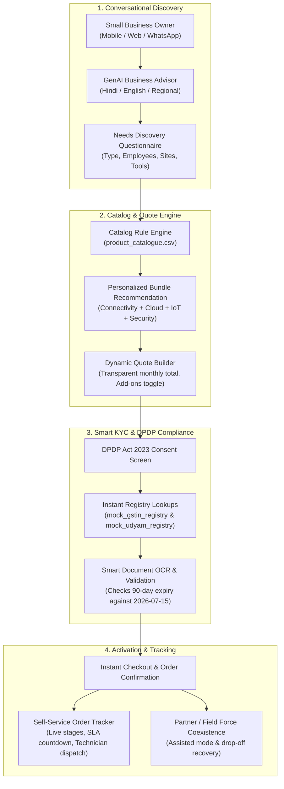
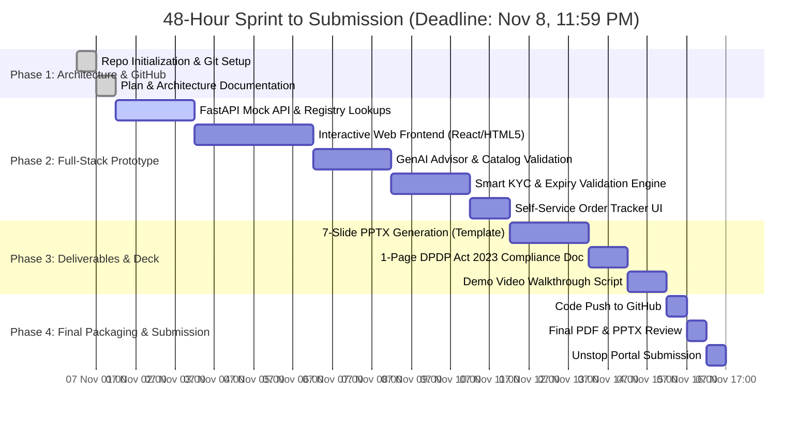

# VyaparSetu (व्यापारसेतु) · Execution Plan & Blueprint
## Airtel Sync 2026 · Enterprise Track A (Project Udyam Digital)
**Platform Name:** **VyaparSetu** (*The Digital Bridge for MSME Commerce*)  
**Team:** Hacker_247 · November 2026  
**Theme:** *Making small businesses go digital in one sitting*

---

## 1. Executive Summary & Problem Context

Accel Business (B2B arm of Accel Telecom / Airtel) serves large enterprises effectively but struggles with India's 6 Crore+ Micro, Small, and Medium Enterprises (MSMEs). 

### The Baseline Reality (from `smb_leads.csv`):
* **Funnel Conversion:** Only **7.36%** of leads reach activation (368 out of 5,000 leads).
* **Onboarding Friction:** Takes **17.6 days** on average from initial lead creation to activation.
* **Customer Anxiety:** Leads make **3+ follow-up calls** to chase order and installation status.
* **Blended CAC:** **~₹15,000** per activated customer against an average micro-bundle value of ~₹2,500/month.
* **Severe Drop-offs:**
  1. *Unreachable / No time for physical field visit:* **1,632 leads** lost due to sales-led scheduling friction.
  2. *Pricing and Quote complexity:* **1,006 leads** lost due to opaque pricing, complex multi-line PDFs, and delays.
  3. *Paperwork & Documentation:* **273 leads** lost to missing GST/Udyam certificates, expired proofs, and signature bottlenecks.
  4. *GSTIN Disparity:* Leads with GSTIN activate at **9.56%** vs. only **2.05%** for non-GST leads.

---

## 2. Core Solution: Project Udyam Digital

A frictionless, digital-first acquisition and self-serve onboarding journey that eliminates sales delays and empowers MSME owners to discover, configure, verify, and track their digital bundle on mobile in **under 10 minutes**.

---

## 3. Detailed Technical Architecture & Components

### Component 1: GenAI Conversational Advisor
* **Multilingual Interaction:** Natural language conversational assistant in English, Hindi, and regional dialects.
* **Intelligent Profiling:** Gathers 4 simple inputs:
  1. Business type (Kirana, Clinic, CA firm, Restaurant chain, Small Factory).
  2. Location & City Tier (Tier 1 vs. Tier 2).
  3. Size (Employee count & Number of operating sites).
  4. Core daily pain points (Payment uptime, cloud backup, security, customer outreach).
* **Deterministic Rule Adherence (`product_catalogue.csv`):**
  - Enforces `requires_gstin` (e.g. restricts Leased Lines or 1G Fibre for non-GST businesses).
  - Enforces `requires_one_of` dependencies (e.g. Cloud CCTV `P23` requires base connectivity `P01-P06`).
  - Enforces `min_employees` and `min_sites` limits.
* **Pre-configured Tailored Packs:**
  - *Kirana & Retail Digital Booster:* Biz Fibre 100 + Cloud POS & Billing + WhatsApp API (~₹2,597/mo).
  - *Clinic & Healthcare Pro:* Biz Fibre 300 + Cloud Email + Cloud Backup 1TB + Secure Guest Wi-Fi (~₹2,522/mo).
  - *Multi-Site Enterprise Mini:* Biz Fibre 300 + 4G Failover + SD-WAN + Cloud CCTV (~₹4,697/mo).

### Component 2: Dynamic Quote & Transparent Checkout
* Single transparent monthly bill with 0 hidden fees.
* Granular add-on toggling with live pricing recalculation.
* Plain-English contract terms (e.g. 12-month lock-in vs. monthly flexibility).

### Component 3: Smart KYC Engine & Instant Registry Verification
* **1-Click Auto-Fill:** 
  - Input GSTIN $\rightarrow$ queries `mock_gstin_registry.csv` to fetch Legal Name, Trade Name, Registered Address, and Status.
  - Input Udyam No $\rightarrow$ queries `mock_udyam_registry.csv` to verify MSME classification and entity name.
* **Automated Document Sanity Checks:**
  - **Date Expiry Check:** Evaluates address proofs against the hackathon reference date: **July 15, 2026** (rejects documents >90 days old).
  - **Status Checks:** Rejects Suspended or Cancelled GSTINs.
  - **Entity Consistency:** Cross-matches signatory identity and address proof names with registry entries.
  - **Defect Detection:** Accurately flags missing files (e.g., Applicant K05 lacking Udyam certificate).

### Component 4: DPDP Act 2023 Compliance Layer
* Explicit, granular digital consent mechanism before collecting documents.
* **Data Minimisation:** Restricts collection to mandatory verification fields only.
* **Identifier Masking:** Masks GSTIN (displays `32TTNXXXXXX1ZW`), PAN, and Aadhaar across client-facing UI and server logs.
* **Retention Policy:** Automated document purging schedule post-verification.

### Component 5: Real-Time Self-Serve Order Tracker
* Visual milestone tracking:
  `Order Placed` $\rightarrow$ `Digital KYC Verified` $\rightarrow$ `Feasibility Passed` $\rightarrow$ `Engineer Assigned` $\rightarrow$ `Activated`.
* Displays expected installation timeline based on `typical_install_days` from the catalog.
* Resolves customer anxiety, targeting a **>85% reduction in status chase calls**.

### Component 6: Channel Partner & Field-Force Synergy (Stretch Goal)
* **Partner Assisted Mode:** Tablet-optimized view for local partners and field reps to guide non-digital owners through the journey in 1 sitting.
* **Dropped Lead Recovery:** Identifies high-propensity dropped leads (e.g. stalled at Quote or KYC) and alerts partners for assisted closure with commission attribution.

---

## 4. Submission Deliverables & 7-Slide Deck Structure

Following Unstop's mandatory **7-slide PPT/PDF** requirement (`TeamName_CampusName.pptx`):

| Slide | Topic | Content Summary |
|---|---|---|
| **Cover** | Title & Credentials | Project Udyam Digital · Team Hacker_247 · Campus Name |
| **Slide 1** | **Problem Diagnosis & MSME Segmentation** | Funnel breakdown (5,000 leads $\rightarrow$ 368 activations; 7.36% conversion), ₹15k CAC, 17.6 days delay; deep-dive into the 4 MSME segments and reasons for drop-offs. |
| **Slide 2** | **Detailed Competitive Analysis** | Benchmark against Jio Business, Tata Tele (TTBS), and unorganized local ISPs; Airtel's right-to-win via an integrated digital ecosystem. |
| **Slide 3** | **Proposed Solution: Project Udyam Digital** | End-to-end self-serve mobile journey: Conversational Discovery, Dynamic Quote, Smart KYC, and Order Tracker. |
| **Slide 4** | **Technical Architecture & Core Modules** | Full stack diagram, catalog rule engine, registry API integration, and clickable links to **GitHub Repository** and **3-Minute Demo Video**. |
| **Slide 5** | **Smart KYC Engine & DPDP Act 2023 Compliance** | Instant registry validation, synthetic PAN/Udyam format verification, 90-day expiry enforcement (ref: 2026-07-15), consent and data masking. |
| **Slide 6** | **Partner & Field-Force Coexistence Model** | Assisted Mode for channel partners, commission attribution, and AI propensity scoring for dropped-lead salvage. |
| **Slide 7** | **Business Impact, Unit Economics & 5 Core Metrics** | Conversion (7.4% $\rightarrow$ 25%), CAC (₹15,000 $\rightarrow$ ₹2,800), Time to Activate (17.6 days $\rightarrow$ <48 hrs), Churn & NPS impact, 3-year ARR projection. |

---

## 5. Execution Timeline & Milestones (48-Hour Sprint)

---

## 6. Target Key Performance Indicators (KPIs)

| Metric | Current Baseline | Project Udyam Digital Target | Business Impact |
|---|---|---|---|
| **Lead-to-Activation Conversion** | 7.36% | **24.5%** | **3.3x increase** in activated MSMEs per 1,000 leads |
| **Customer Acquisition Cost (CAC)** | ₹15,000 | **₹2,800** | **81% reduction** via self-serve digital onboarding |
| **Lead-to-Activation Cycle Time** | 17.6 days | **< 48 hours** | Rapid fulfillment; 0 paper delays |
| **Customer Status Chase Calls** | 3.2 calls / customer | **< 0.3 calls / customer** | Transparent order tracking saves call center load |
| **Net Promoter Score (NPS)** | 4.8 / 10 | **8.2 / 10** | High satisfaction from transparent pricing & instant setup |

---
*Created for Airtel Sync 2026 Hackathon · Team Hacker_247*

