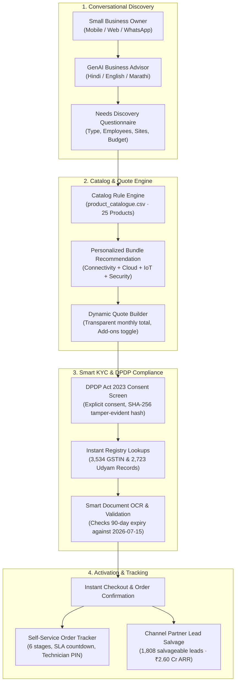

# VyaparSetu (व्यापारसेतु) · Execution Plan & Blueprint
## Airtel Sync 2026 · Enterprise Track A (Project Udyam Digital)
**Platform Name:** **VyaparSetu** (*The Digital Bridge for MSME Commerce*)  
**Team:** Hacker_247 · ABV-IIITM Gwalior (Abhishek Kokadwar, Sumit Sahu)  
**Theme:** *Making small businesses go digital in one sitting*

---

## 1. Executive Summary & Problem Context

Accel Business (B2B arm of Accel Telecom / Airtel) serves large corporate enterprises effectively but faces severe acquisition friction with India's 6 Crore+ Micro, Small, and Medium Enterprises (MSMEs). 

### The Baseline Reality (Empirical Evidence from `smb_leads.csv`):
* **Funnel Conversion:** Only **7.36%** of incoming leads reach service activation (368 out of 5,000 leads).
* **Onboarding Friction:** Takes **17.6 days** on average from initial lead creation to live activation.
* **Customer Anxiety:** Leads make **3.0 follow-up calls** chasing order and field technician status.
* **Blended Customer Acquisition Cost (CAC):** **₹15,053** per activated customer (Total acquisition marketing spend ₹55,39,640 across 5,000 leads divided by 368 activated customers).
* **Severe Drop-offs (4,632 dropped leads · 92.64% drop rate):**
  1. *Sales Inactivity & Scheduling Delay:* **1,632 leads (35.2%)** lost to slow physical rep assignment (805 unreachable, 827 scheduling friction).
  2. *Pricing & Quotation Complexity:* **1,006 leads (21.7%)** lost due to opaque pricing and multi-vendor confusion.
  3. *Paperwork & Documentation Friction:* **273 leads (5.9%)** lost to missing GST/Udyam certificates, expired utility proofs, and signature bottlenecks.
  4. *GSTIN Disparity:* Leads with GSTIN activate at **9.56%** vs. only **2.05%** for unregistered micro-entities.
  5. *NPS Score Baseline:* **6.9 / 10** average customer satisfaction score.

---

## 2. Core Solution: Project Udyam Digital

A frictionless, digital-first acquisition and self-serve onboarding journey that eliminates sales delays and empowers MSME owners to discover, configure, verify, and track their digital bundle on mobile in **under 10 minutes**.

---

## 3. Detailed Technical Architecture & Components

### Component 1: GenAI Conversational Advisor (VyaparSaarthi)
* **Multilingual Interaction:** Natural language conversational assistant in English, Hindi, Marathi, and regional dialects.
* **Intelligent Profiling:** Gathers 4 simple inputs:
  1. Business type (Kirana, Clinic, CA firm, Restaurant chain, Small Factory).
  2. Location & City Tier (Tier 1 vs. Tier 2).
  3. Size (Employee count & Number of operating sites).
  4. Core daily pain points (Payment uptime, cloud backup, security, customer outreach).
* **Deterministic Rule Adherence (`product_catalogue.csv`):**
  - Enforces `requires_gstin` (e.g. restricts Leased Lines or 1G Fibre for non-GST businesses).
  - Enforces `requires_one_of` dependencies (e.g. Cloud CCTV `P23` requires base connectivity `P01-P06`).
  - Enforces `min_employees` and `min_sites` limits.
* **Pre-configured Tailored Packs:**
  - *Kirana & Retail Digital Booster:* Biz Fibre 100 + Cloud POS & Billing + Business Postpaid SIM + Cloud CCTV (~₹2,196/mo).
  - *Clinic & Healthcare Pro:* Biz Fibre 300 + Cloud Email + Cloud Backup 1TB + Secure Guest Wi-Fi + Static IP (~₹3,097/mo for 4 staff).
  - *Multi-Site Enterprise Mini:* Biz Fibre 300 + 4G Failover + SD-WAN + Cloud CCTV (~₹4,697/mo).

### Component 2: Dynamic Quote & Transparent Checkout
* Single transparent monthly bill with 0 hidden fees.
* Granular add-on toggling with live pricing recalculation.
* Plain-English contract terms (e.g. 12-month lock-in vs. monthly flexibility).

### Component 3: Smart KYC Engine & Instant Registry Verification
* **1-Click Auto-Fill:** 
  - Input GSTIN $\rightarrow$ queries `mock_gstin_registry.csv` (3,534 records) to fetch Legal Name, Trade Name, Registered Address, and Status.
  - Input Udyam No $\rightarrow$ queries `mock_udyam_registry.csv` (2,723 records) to verify MSME classification and entity name.
* **Automated Document Sanity Checks:**
  - **Date Expiry Check:** Evaluates address proofs against the hackathon reference date: **July 15, 2026** (rejects documents >90 days old; catches **K11** at 257 days old).
  - **Status Checks:** Rejects Suspended or Cancelled GSTINs (catches **K01** Cancelled status).
  - **Registry Verification:** Validates extracted GSTIN against National Registry (catches **K06** non-existent GSTIN).
  - **Entity Consistency:** Cross-matches legal entity on certificate with registry records (catches **K07** Shri Physio vs Neelgiri Physio mismatch).
  - **Defect Detection:** Accurately flags missing files (catches **K05** missing Udyam; **K04** blank image).

### Component 4: DPDP Act 2023 Compliance Layer
* Explicit, granular digital consent mechanism before collecting documents.
* **Data Minimisation:** Restricts collection to mandatory verification fields only.
* **Identifier Masking:** Masks central PAN characters in GSTIN (displays `37IHXXXXXX7L1ZS`), PAN, and phone numbers across client-facing UI and server logs.
* **Cryptographic Audit Ledger:** SHA-256 tamper-evident hash logged for every consent grant and withdrawal event.
* **Retention Policy:** Automated document purging schedule post-verification (180-day retention).

### Component 5: Real-Time Self-Serve Order Tracker
* Visual milestone tracking (6 stages):
  `Order Placed` $\rightarrow$ `Digital KYC Verified` $\rightarrow$ `Feasibility Passed` $\rightarrow$ `Field Engineer Assigned` $\rightarrow$ `Site Installation` $\rightarrow$ `Service Activated`.
* Displays expected installation timeline based on `typical_install_days` from the catalog with strict technical floor enforcement (e.g. 21 days for Leased Line).
* 4-digit technician activation PIN to authenticate physical hand-over.

### Component 6: Channel Partner & Field-Force Synergy
* **Partner Assisted Mode:** Tablet-optimized view for local partners and field reps to guide non-digital owners through the journey in 1 sitting.
* **Dropped Lead Recovery:** Identifies **1,808 high-propensity dropped leads** (>65 score) representing **₹2.60 Crore in salvageable ARR**.
* **Partner Commission Attribution Ledger:** Allocates an attractive **15% revenue share commission** (~₹39.0 Lakh pool) to channel partners for successful win-back activations.

---

## 4. Submission Deliverables & 7-Slide Deck Structure

Following Unstop's mandatory **7-slide PPT/PDF** requirement (`Hacker_247_ABVIIITMGwalior.pptx`):

| Slide | Topic | Content Summary |
|---|---|---|
| **Cover** | Title & Credentials | Project Udyam Digital · Team Hacker_247 · ABV-IIITM Gwalior |
| **Slide 1** | **Problem Diagnosis & MSME Sizing** | Empirical baseline: 5,000 leads $\rightarrow$ 368 activations (7.36% conversion), ₹15,053 blended CAC, 17.6 days delay; 49% pure process friction. |
| **Slide 2** | **Competitive Differentiation** | Benchmark against Jio Business, Tata Tele (TTBS), and local ISPs; Accel/Airtel's single-bill ecosystem. |
| **Slide 3** | **Proposed Solution: VyaparSetu** | 10-minute self-serve mobile journey: Advisor, Quote Builder, Smart KYC, and Order Tracker. |
| **Slide 4** | **Technical Architecture & Core Engine** | FastAPI backend (28 REST endpoints), deterministic catalogue rules, and DPDP compliance ledger. |
| **Slide 5** | **Smart KYC & DPDP Compliance** | Real OCR field extraction, 90-day expiry enforcement, cross-document reconciliation, 6 PASS / 6 REJECT. |
| **Slide 6** | **Channel Partner Coexistence Model** | 1,808 salvageable leads, ₹2.60 Cr recoverable ARR, 15% commission, automated WhatsApp win-back playbooks. |
| **Slide 7** | **Business Impact & Unit Economics** | Conversion (7.36% $\rightarrow$ 24.5%), CAC (₹15,053 $\rightarrow$ ₹2,800), Cycle Time (17.6 days $\rightarrow$ <48 hrs), NPS (6.9 $\rightarrow$ 8.5+). |

---

## 5. Target Key Performance Indicators (KPIs)

| Metric | Current Baseline (Empirical) | Project Udyam Digital Target | Business Impact |
|---|---|---|---|
| **Lead-to-Activation Conversion** | 7.36% (368 / 5,000) | **15.0%** | **2.0x increase** in activated MSMEs per 1,000 leads |
| **Blended Customer Acquisition Cost (CAC)** | ₹15,053 / customer | **≤ ₹7,500** | **> 50% reduction** via self-serve digital onboarding |
| **Lead-to-Activation Cycle Time** | 17.6 days | **≤ 5 Days** | Rapid fulfillment; 0 physical paperwork delays |
| **Customer Status Chase Calls** | 3.0 calls / lead | **< 0.5 calls / lead** | Transparent milestone tracker eliminates status follow-ups |
| **Net Promoter Score (NPS)** | 6.9 / 10 | **8.5+ / 10** | High satisfaction from transparent pricing & instant setup |

---
*Created for Airtel Sync 2026 Hackathon · Team Hacker_247 · ABV-IIITM Gwalior*
