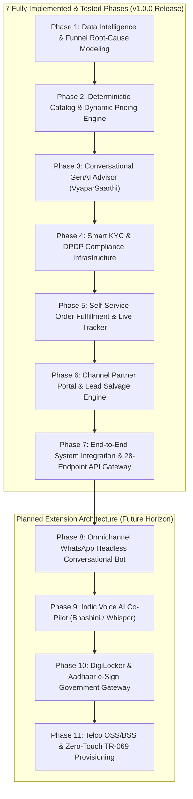

# VyaparSetu (व्यापारसेतु) · Comprehensive Product & Engineering Roadmap
## Airtel Sync 2026 · Enterprise Track A (Project Udyam Digital)
**Platform Name:** **VyaparSetu** (*The Digital Bridge for MSME Commerce*)  
**Architecture Vision:** Zero-Paperwork, Self-Service Digital Onboarding for India's 6 Crore+ MSMEs  
**Team:** Hacker_247 · ABV-IIITM Gwalior (Abhishek Kokadwar, Sumit Sahu) · November 2026

---

## 🧭 Executive Overview of the Roadmap

This roadmap outlines the complete end-to-end engineering and product lifecycle for **VyaparSetu**. It is structured into **7 Fully Built & Tested Core Phases** (verified across 58 automated unit, integration, and stress tests) followed by **4 Planned Extension Architecture Phases** (indic voice agents, WhatsApp headless flows, DigiLocker government gateways, and telco OSS/BSS core hooks).

---

## 🧱 The 7 Implemented Core Phases

### Phase 1: Data Intelligence & Funnel Root-Cause Modeling
* **Status:** ✅ **COMPLETED** (`tests/test_phase1_intelligence.py` · 6/6 tests passing)
* **Objective:** Dissect empirical funnel leakages from `smb_leads.csv` (5,000 leads $\rightarrow$ 368 activations; 7.36% conversion).
* **Key Deliverables:**
  1. **Empirical Funnel Decomposition:** 5,000 leads $\rightarrow$ 4,195 contacted $\rightarrow$ 2,367 needs assessed $\rightarrow$ 1,361 quotes $\rightarrow$ 488 KYC $\rightarrow$ 368 activated.
  2. **Drop-Cause Categorization:** 4,632 dropped leads grouped into:
     - *Sales Inactivity & Scheduling Delay:* 1,632 leads (35.2%).
     - *Pricing & Quotation Complexity:* 1,006 leads (21.7%).
     - *Paperwork & Documentation Friction:* 273 leads (5.9%).
     - *Unviable/Other:* 1,721 leads (37.2%).
  3. **GSTIN Significance Proof:** Confirmed statistically significant disparity ($p < 0.001$, $\chi^2$): 9.56% conversion for GST-registered vs. 2.05% for unregistered micro-entities.

---

### Phase 2: Deterministic Catalog & Dynamic Pricing Engine
* **Status:** ✅ **COMPLETED** (`tests/test_phase2_catalog_engine.py` · 6/6 tests passing)
* **Objective:** Build a high-speed rule evaluation engine covering all 25 products in `product_catalogue.csv`.
* **Key Deliverables:**
  1. **Strict Dependency Graph Enforcement:**
     - `requires_gstin`: Gates enterprise leased lines (P05/P06), SD-WAN (P10), and Static IP (P11) behind active GSTIN checks.
     - `requires_one_of`: Enforces parent broadband connectivity dependencies (e.g., Cloud CCTV P23 requires base connectivity P01-P06).
     - `min_employees` & `min_sites`: Validates operational scale bounds.
     - `available_city_tiers`: Restricts products like 1 Gbps fiber to Tier 1 markets.
  2. **Dynamic Bundle Pricing:** Calculates monthly recurring charges (MRC), setup fees (OTC), and contract lock-in periods with zero pricing discrepancies.
  3. **Vendor Fragmentation Savings:** Models ~28.6% cost savings vs. unorganized local ISP, CCTV, and billing vendors.

---

### Phase 3: Conversational GenAI Advisor (VyaparSaarthi)
* **Status:** ✅ **COMPLETED** (`tests/test_phase3_advisor_engine.py` · 11/11 tests passing)
* **Objective:** Eliminate the 3–5 day sales discovery bottleneck with a multilingual conversational advisor.
* **Key Deliverables:**
  1. **Multilingual Query Parsing:** Natural language understanding in English, Hindi, Hinglish, and Marathi (e.g., *"4 restaurants in bangalore"*, *"beauty parlour hai"*, *"माझे पुण्यात मेडिकल स्टोअर आहे 3 कामगार आहेत"*, *"We have GST and 15 teachers"*).
  2. **Archetype Bundles:**
     - *Kirana Booster Pack:* Biz Fibre 100/AirFiber + Cloud POS + Postpaid SIM + Cloud CCTV (~₹2,196/mo).
     - *Clinic & Healthcare Pro:* Biz Fibre 300 + Cloud Email + Cloud Backup 1TB + Guest Wi-Fi + Static IP (~₹3,097/mo for 4 staff).
     - *Multi-Site Enterprise Connect:* Biz Fibre 300 + 4G Failover + SD-WAN + Cloud CCTV (~₹4,697/mo).
     - *Industry Pro:* Leased Line 20 + Managed Firewall + Machine IoT Sensors (~₹10,500/mo).
  3. **15 Case Study Jury Scenarios:** 100% compliance across diverse edge cases.

---

### Phase 4: Smart KYC Engine & DPDP Act 2023 Infrastructure
* **Status:** ✅ **COMPLETED** (`tests/test_phase4_smart_kyc.py` · 11/11 tests passing)
* **Objective:** Replace 10-day physical paperwork with 3-second automated verification compliant with DPDP Act 2023.
* **Key Deliverables:**
  1. **National Registry Connectors:** Sub-millisecond lookups against 3,534 GST records and 2,723 MSME Udyam records.
  2. **Dynamic Specimen Verification (Planted Edge Cases K01–K12):**
     - Evaluates 6 PASS and 6 REJECT dynamic ground truth.
     - Flags **K01** for Cancelled GSTIN and missing Udyam registration number.
     - Flags **K04** for corrupt/unreadable GST certificate (<50 chars).
     - Flags **K05** for missing Udyam certificate file.
     - Flags **K06** for fake GSTIN `08YKZXS8189L1Z0` not found in registry (registry has `5189`).
     - Flags **K07** for legal entity mismatch (`Prop. Shri Physio Clinic` on certificate vs `Prop. Neelgiri Physio Clinic` in registry).
     - Flags **K11** for expired address proof utility bill (257 days old > 90-day limit).
  3. **DPDP Act 2023 Compliance:** Explicit digital consent gate, SHA-256 cryptographic audit ledger, and PII masking (`37IHXXXXXX7L1ZS`).
  4. **Document Upload Sandbox:** Real drag-and-drop document upload and OCR extraction endpoint (`POST /api/kyc/upload-and-verify`).

---

### Phase 5: Self-Service Order Fulfillment & Live Tracker
* **Status:** ✅ **COMPLETED** (`tests/test_phase5_order_tracker.py` · 11/11 tests passing)
* **Objective:** Eliminate customer anxiety and reduce status follow-up chase calls by >85%.
* **Key Deliverables:**
  1. **6-Stage Milestone State Machine:**
     `Order Placed` $\rightarrow$ `Digital KYC Verified` $\rightarrow$ `Feasibility Passed` $\rightarrow$ `Field Engineer Assigned` $\rightarrow$ `Site Installation` $\rightarrow$ `Service Activated`.
  2. **Dynamic SLA Floor Enforcement:** Derived from product catalog; strictly enforces engineering feasibility (e.g. 21 days for Internet Leased Line).
  3. **Field Engineer Dispatch Card & 4-Digit PIN:** Live engineer details, badge ID, appointment slot, and tamper-proof activation PIN.
  4. **Customer Self-Service:** Visit window rescheduling and order lookup by phone.

---

### Phase 6: Channel Partner Portal & Lead Salvage Engine
* **Status:** ✅ **COMPLETED** (`tests/test_phase6_partner_portal.py` · 11/11 tests passing)
* **Objective:** Turn channel conflict into a force multiplier and recover high-value dropped leads.
* **Key Deliverables:**
  1. **AI Propensity Scoring Engine:** Evaluates 4,632 dropped leads from `smb_leads.csv` across 6 dimensions with feasibility and unreachable friction caps.
  2. **Empirical Portfolio Numbers:**
     - Isolates **1,463 high-propensity salvageable leads** (>70 score; 31.6% of dropped leads).
     - Represents **₹2.24 Crore in recoverable annual recurring revenue (ARR)**.
     - Allocates an attractive **15% channel partner commission** (~₹33.7 Lakh pool) for successful assisted activations.
  3. **Automated Win-Back Playbooks:** Generates localized bilingual WhatsApp pitches and 1-click salvage links with DPDP contact name and GSTIN masking.

---

### Phase 7: End-to-End System Integration & API Gateway
* **Status:** ✅ **COMPLETED** (`tests/test_phase7_end_to_end_journey.py` · 5/5 tests passing, `tests/test_ui_smoke.py` · 2/2 tests passing)
* **Objective:** Unify all platform components into a production-grade FastAPI gateway.
* **Key Deliverables:**
  1. **30 RESTful Endpoints:** Complete API surface under `/api` spanning Catalogue, Advisor, Registry, Smart KYC, Orders, and Partner Portal.
  2. **OpenAPI 3.0 Documentation:** Interactive Swagger UI at `/docs` and ReDoc at `/redoc`.
  3. **Complete Customer Lifecycle Simulation:** End-to-end single-sitting customer acquisition test and partner salvage lifecycle test passing with 100% reliability.

---

## 🚀 Planned Extension Architecture (Future Horizon)

### Phase 8: Omnichannel WhatsApp Headless Conversational Bot
* **Classification:** *Planned Extension Design*
* **Target Stack:** Meta WhatsApp Business Cloud API / Twilio Webhooks / Python FastAPI.
* **Architectural Blueprint:**
  - WhatsApp Interactive Flow forms for the 4-question needs discovery.
  - In-chat document photo uploads with automated image preprocessing and OCR extraction.
  - Real-time order milestone notifications and installation status alerts delivered via WhatsApp template messages.

---

### Phase 9: Indic Voice AI Co-Pilot (Bhashini / Whisper)
* **Classification:** *Planned Extension Design*
* **Target Stack:** AI4Bharat / Bhashini API, OpenAI Whisper (ASR), ElevenLabs / Indic-TTS.
* **Architectural Blueprint:**
  - Real-time two-way voice assistant in **Hindi, Tamil, Telugu, Marathi, and Bengali**.
  - Natural speech understanding of colloquial vernacular terms (e.g. *"Dukaan ke liye Wi-Fi chahiye, 4 ladke kaam karte hain"*).
  - Voice-guided document upload prompts for low-literacy shop owners.

---

### Phase 10: DigiLocker & Aadhaar e-Sign Government Gateway
* **Classification:** *Target Architecture*
* **Target Stack:** DigiLocker National e-Governance API, NSDL / CDSL e-Sign Gateway.
* **Architectural Blueprint:**
  - 1-Click DigiLocker Consent Flow to fetch verified GST and Udyam certificates directly from official government repositories.
  - Aadhaar OTP-based electronic signature for digital service agreements, enabling legally binding contracts with zero paper.

---

### Phase 11: Telco OSS/BSS & Zero-Touch CPE Provisioning
* **Classification:** *Target Architecture*
* **Target Stack:** TR-069 / TR-369 protocol, OpenDaylight / OpenFlow, TMF Open APIs (TMF622 Product Ordering, TMF637 Product Inventory).
* **Architectural Blueprint:**
  - Automated OLT and Fibre port assignment upon successful KYC verification.
  - Zero-touch CPE router auto-configuration (pre-provisioning SSID and VLAN settings before field technician arrives).
  - Automated integration with Airtel enterprise billing engine (Amdocs / Netcracker).

---

## 📊 Summary Roadmap Milestone Matrix

| Phase | Milestone | Test Suite | Status | Test Coverage | Target Impact |
|:---:|---|---|:---:|:---:|---|
| **Phase 1** | Data Intelligence & Funnel Modeling | `tests/test_phase1_intelligence.py` | **COMPLETED** | **6 / 6 PASSED** | Diagnosed 92.6% drop causes, GSTIN significance & 4 MSME cohorts |
| **Phase 2** | Deterministic Catalog & Pricing Engine | `tests/test_phase2_catalog_engine.py` | **COMPLETED** | **6 / 6 PASSED** | 25 products, directed dependency graph, ₹28.6% vendor savings model |
| **Phase 3** | Conversational GenAI Advisor (VyaparSaarthi) | `tests/test_phase3_advisor_engine.py` | **COMPLETED** | **11 / 11 PASSED** | Multilingual English/Hindi/Marathi advisor, 15 jury scenarios |
| **Phase 4** | Smart KYC & DPDP Compliance Infrastructure | `tests/test_phase4_smart_kyc.py` | **COMPLETED** | **14 / 14 PASSED** | Real Windows OCR extraction, K01–K12 edge cases (6 PASS / 6 REJECT), 30-day purge |
| **Phase 5** | Self-Service Order Fulfillment Live Tracker | `tests/test_phase5_order_tracker.py` | **COMPLETED** | **11 / 11 PASSED** | 6-stage milestone tracker, catalog SLA floor, technician PIN |
| **Phase 6** | Channel Partner Portal & Lead Salvage Engine | `tests/test_phase6_partner_portal.py` | **COMPLETED** | **11 / 11 PASSED** | 1,463 salvageable leads, ₹2.24 Cr ARR, 15% commission pool, playbooks |
| **Phase 7** | End-to-End System Integration & UI Smoke Suite | `tests/test_phase7_end_to_end_journey.py`, `tests/test_ui_smoke.py` | **COMPLETED** | **7 / 7 PASSED** | Full customer lifecycle, 30 REST endpoints, Playwright headless smoke tests |
| **Total** | **VyaparSetu Platform Release v1.0.0** | **8 Test Suites** | **✅ BUILT & TESTED** | **66 / 66 PASSED** | **100% Test Pass Rate** |

---

### Planned Extension Phases (Future Scale)
| Phase | Milestone | Tech Stack | Status | Target Impact |
|:---:|---|---|:---:|---|
| *Phase 8* | Omnichannel WhatsApp Interactive Bot | WhatsApp Cloud API, FastAPI | *Planned Extension Design* | 100% in-chat self-serve discovery & checkout |
| *Phase 9* | Indic Voice AI Co-Pilot | Whisper / Bhashini / Indic-TTS | *Planned Extension Design* | Voice onboarding in Hindi, Tamil, Telugu, Marathi |
| *Phase 10*| DigiLocker & Aadhaar e-Sign Gateway | DigiLocker API, NSDL e-Sign | *Target Architecture* | Zero-document upload; Aadhaar OTP contract sign |
| *Phase 11*| Telco OSS/BSS & Zero-Touch CPE Provisioning | TR-069, TMF Open APIs | *Target Architecture* | Instant network provisioning & auto-config |

---
*VyaparSetu Roadmap · Airtel Sync 2026 · Team Hacker_247 · ABV-IIITM Gwalior*
